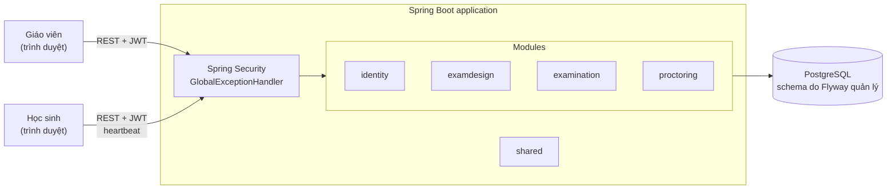
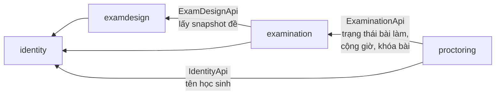
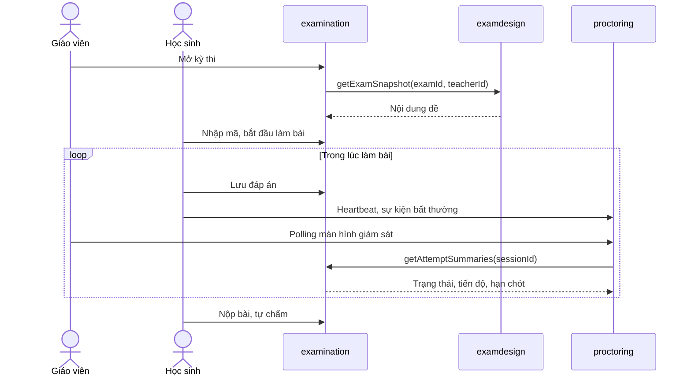

# Exam-Practice

Hệ thống thi và luyện thi trực tuyến: **giáo viên** soạn đề, mở kỳ thi và giám sát học sinh làm bài; **học sinh** tham gia kỳ thi bằng mã và làm bài trong thời gian quy định.

## Mục lục

- [1. Giới thiệu](#1-giới-thiệu)
- [2. Problem & Solution (Vấn đề & Giải pháp)](#2-problem--solution-vấn-đề--giải-pháp)
  - [2.1. Bài toán của giáo viên và học sinh](#21-bài-toán-của-giáo-viên-và-học-sinh)
  - [2.2. Tình huống phát sinh khi đang thi](#22-tình-huống-phát-sinh-khi-đang-thi)
  - [2.3. Vấn đề kỹ thuật](#23-vấn-đề-kỹ-thuật)
- [3. Core Features (Tính năng cốt lõi)](#3-core-features-tính-năng-cốt-lõi)
  - [3.1. Tài khoản (`identity`)](#31-tài-khoản-identity)
  - [3.2. Giáo viên soạn đề (`examdesign`)](#32-giáo-viên-soạn-đề-examdesign)
  - [3.3. Tổ chức kỳ thi (`examination`)](#33-tổ-chức-kỳ-thi-examination)
  - [3.4. Giám sát kỳ thi (`proctoring`)](#34-giám-sát-kỳ-thi-proctoring)
  - [3.5. Ngoài phạm vi MVP](#35-ngoài-phạm-vi-mvp)
- [4. System Architecture (Kiến trúc hệ thống)](#4-system-architecture-kiến-trúc-hệ-thống)
  - [4.1. Tổng quan](#41-tổng-quan)
  - [4.2. Module và hướng phụ thuộc](#42-module-và-hướng-phụ-thuộc)
  - [4.3. Cấu trúc bên trong một module](#43-cấu-trúc-bên-trong-một-module)
  - [4.4. Luồng chính của một kỳ thi](#44-luồng-chính-của-một-kỳ-thi)
  - [4.5. Ràng buộc kiến trúc](#45-ràng-buộc-kiến-trúc)
  - [4.6. Trạng thái và dữ liệu](#46-trạng-thái-và-dữ-liệu)
- [5. Chạy dự án](#5-chạy-dự-án)
- [6. API Documentation (Tài liệu API & Chuẩn giao tiếp)](#6-api-documentation-tài-liệu-api--chuẩn-giao-tiếp)
  - [6.1. Tra cứu tài liệu tự động](#61-tra-cứu-tài-liệu-tự-động)
  - [6.2. Quy ước chung](#62-quy-ước-chung)
  - [6.3. Xác thực](#63-xác-thực)
  - [6.4. HTTP method và status code khi thành công](#64-http-method-và-status-code-khi-thành-công)
  - [6.5. Response thành công](#65-response-thành-công)
    - [6.5.1. Phân trang](#651-phân-trang)
  - [6.6. Response lỗi: ProblemDetail (RFC 9457)](#66-response-lỗi-problemdetail-rfc-9457)
  - [6.7. Mã lỗi](#67-mã-lỗi)
  - [6.8. Quy tắc cho backend](#68-quy-tắc-cho-backend)
  - [6.9. Checklist khi thêm endpoint mới](#69-checklist-khi-thêm-endpoint-mới)
- [7. Development / Contribution (Quy chuẩn phát triển & Đóng góp)](#7-development--contribution-quy-chuẩn-phát-triển--đóng-góp)
  - [7.1. Chuẩn bị môi trường](#71-chuẩn-bị-môi-trường)
  - [7.2. Quy trình làm việc](#72-quy-trình-làm-việc)
  - [7.3. Quy ước commit](#73-quy-ước-commit)
  - [7.4. Kiểm thử](#74-kiểm-thử)
  - [7.5. Thêm tính năng vào một module](#75-thêm-tính-năng-vào-một-module)
  - [7.6. Quy ước viết code](#76-quy-ước-viết-code)
  - [7.7. Review](#77-review)

## 1. Giới thiệu

- **Công nghệ:** Java 21, Spring Boot 4, Spring Data JPA, Spring Security (JWT), Flyway, PostgreSQL; test bằng JUnit 5, ArchUnit, Testcontainers
- **Kiến trúc:** modular monolith, gồm 4 module là các package con của `vn.exampractice`

| Module | Trách nhiệm |
|---|---|
| `identity` | Tài khoản, vai trò (STUDENT, TEACHER), đăng nhập |
| `examdesign` | Soạn câu hỏi, ghép đề |
| `examination` | Kỳ thi, tham gia bằng mã, lượt làm bài, tự chấm |
| `proctoring` | Giám sát: heartbeat, sự kiện bất thường, bảng theo dõi |

Ranh giới giữa các module được kiểm tra tự động bởi `ModuleBoundaryTest` (ArchUnit).

Lý do của các quyết định kỹ thuật (bối cảnh, phương án đã cân nhắc, hệ quả) được ghi trong **[docs/adr](docs/adr/README.md)**.

## 2. Problem & Solution (Vấn đề & Giải pháp)

### 2.1. Bài toán của giáo viên và học sinh

| Vấn đề | Giải pháp |
|---|---|
| Thi giấy tốn công in đề, thu bài, chấm và tổng hợp điểm | Thi trực tuyến, **tự chấm** trắc nghiệm ngay khi nộp |
| Cùng một đề phải tổ chức lại cho nhiều lớp, nhiều đợt | Đề soạn một lần, **dùng lại** cho nhiều kỳ thi |
| Giáo viên không biết học sinh đang làm gì khi thi trực tuyến | **Màn hình giám sát**: trạng thái, tiến độ, thời gian còn lại của từng học sinh |
| Học sinh rời trang để tra cứu khi đang thi | **Ghi nhận sự kiện bất thường** (rời tab, thoát toàn màn hình) để giáo viên xử lý |
| Tổ chức thi nhanh mà chưa có sẵn danh sách lớp | Tham gia bằng **mã kỳ thi**, học sinh chỉ cần đăng nhập và nhập mã |

### 2.2. Tình huống phát sinh khi đang thi

| Vấn đề | Giải pháp |
|---|---|
| Giáo viên sửa đề trong lúc kỳ thi đang diễn ra | Chụp **snapshot đề** khi mở kỳ thi; sửa đề gốc chỉ áp dụng cho các kỳ thi sau |
| Học sinh mất kết nối hoặc tải lại trang | Đáp án **tự động lưu** lên server; quay lại thì làm tiếp từ chỗ cũ |
| Mất kết nối chưa chắc là gian lận | Hệ thống **chỉ hiển thị và ghi nhật ký**, không tự động xử lý; giáo viên quyết định cộng giờ hay khóa bài |
| Học sinh chỉnh đồng hồ máy để kéo dài thời gian | Thời gian tính theo **giờ server**; hết giờ thì tự nộp |
| Hết giờ nhưng học sinh không bấm nộp (đóng trình duyệt, mất mạng) | **Job trên server tự chốt bài** khoảng mỗi 30 giây và chấm điểm từ đáp án đã lưu; không phụ thuộc vào trình duyệt |
| Đáp án đúng bị lộ qua API khi đang làm bài | Dữ liệu gửi xuống trình duyệt **không chứa đáp án đúng**; chỉ server chấm |
| Học sinh sửa đáp án sau khi đã nộp | Bài làm có **vòng đời trạng thái**; luật nằm trong entity nên không có đường tắt |
| Người ngoài vào thi, mã kỳ thi bị lộ | Bắt buộc đăng nhập; giáo viên **khóa tham gia** khi lớp đã vào đủ ([ADR-0010](docs/adr/0010-tham-gia-bang-ma-ky-thi.md)); giới hạn số lần nhập sai |
| Phát hiện đề sai đáp án khi đang thi | MVP: giữ nguyên kỳ thi, sửa đề gốc cho lần sau. Sau MVP: chấm lại hoặc hủy câu cho cả kỳ thi |

### 2.3. Vấn đề kỹ thuật

| Vấn đề | Giải pháp |
|---|---|
| Code các phần dính chặt vào nhau, sửa một chỗ hỏng chỗ khác | **Modular monolith**: 4 module chỉ giao tiếp qua Public Api; ranh giới kiểm tra tự động bằng ArchUnit |
| Quan hệ JPA (`@ManyToOne`, `@OneToMany`) chạy query ngầm khi truy cập, dễ sinh lỗi **N+1 query** và buộc chặt các entity với nhau | **Flat ID Linking**: giữa các module và giữa các thực thể chính chỉ lưu ID; service gom ID rồi lấy dữ liệu liên quan **bằng một query** (`IN (...)`) và ghép trong bộ nhớ. Quan hệ JPA chỉ dùng cho thực thể con bên trong một thực thể chính (`Attempt` → `Answer`) |
| Dữ liệu giám sát sao chép từ module khác có thể bị lệch so với thực tế | `proctoring` chỉ lưu dữ liệu riêng của nó (heartbeat, nhật ký sự kiện bất thường); trạng thái bài làm **hỏi `ExaminationApi`** mỗi lần giáo viên xem, nên không bao giờ lệch |
| Schema database lệch giữa các môi trường | **Flyway** quản lý migration; Hibernate chỉ kiểm tra (`validate`) |
| Mỗi API trả lỗi một kiểu, frontend khó xử lý | Mọi lỗi theo chuẩn **ProblemDetail** (RFC 9457) kèm `code` cố định |
| Lombok và MapStruct sinh code ẩn lúc biên dịch: khó lần theo luồng dữ liệu, `@Data`/`@Setter` tạo setter public phá vỡ luật của entity | **Không dùng Lombok và MapStruct.** DTO dùng `record`; entity tự viết constructor và chỉ các getter cần thiết, **không có setter**; chuyển entity sang DTO bằng hàm viết tay (`QuestionDto.from(question)`) |

Lý do chi tiết và các phương án đã cân nhắc: xem [các ADR](docs/adr/README.md).

## 3. Core Features (Tính năng cốt lõi)

Phạm vi bản MVP. Luồng chính:

```
Giáo viên soạn đề ─▶ mở kỳ thi (sinh mã) ─▶ học sinh nhập mã, làm bài ─▶ nộp bài, tự chấm
                                                     │
                                         giáo viên giám sát và can thiệp
```

### 3.1. Tài khoản (`identity`)

- Đăng ký, đăng nhập bằng JWT
- Hai vai trò: **STUDENT** (học sinh) và **TEACHER** (giáo viên)
- MVP: người đăng ký tự chọn vai trò, kể cả TEACHER (chưa có duyệt tài khoản giáo viên)

### 3.2. Giáo viên soạn đề (`examdesign`)

- Tạo, sửa, xóa **câu hỏi trắc nghiệm** (nhiều lựa chọn, một đáp án đúng)
- Tìm kiếm và phân trang ngân hàng câu hỏi của mình
- Ghép câu hỏi thành **đề thi**: chọn câu, sắp thứ tự, đặt thời lượng làm bài (1–300 phút); tối đa 100 câu một đề
- **Mỗi câu 1 điểm**; điểm bài quy về thang điểm giáo viên chọn khi tạo kỳ thi: số câu đúng / tổng số câu × thang điểm, làm tròn 2 chữ số ([ADR-0016](docs/adr/0016-moi-cau-mot-diem-quy-ve-thang-10.md))
- Một đề có thể dùng lại cho nhiều kỳ thi

### 3.3. Tổ chức kỳ thi (`examination`)

Các dòng xếp theo thứ tự diễn ra của một kỳ thi:

| Giáo viên | Học sinh |
|---|---|
| Tạo **kỳ thi** từ một đề, với giờ mở và giờ đóng, **thang điểm** (1–100, mặc định 10) và **học sinh được xem gì** sau khi thi; hệ thống sinh **mã tham gia** (6 ký tự) | Nhập mã để **tham gia** kỳ thi và vào phòng chờ |
| Kỳ thi **tự mở khi tới giờ mở** (giáo viên được mở sớm) và **tự đóng khi tới giờ đóng**; lúc mở hệ thống **chụp snapshot đề**, nên sửa đề gốc sau đó không ảnh hưởng bài đang thi. Kỳ thi đã lên lịch mà đề bị lưu trữ hoặc bị bỏ hết câu thì được **đánh dấu** để giáo viên sửa đề hoặc tạo lại trước giờ thi; tới giờ mở mà đề vẫn không dùng được thì kỳ thi **tự hủy** | **Bắt đầu làm bài** khi kỳ thi đã mở; mỗi học sinh một lượt làm bài |
| Khóa không cho vào thêm khi lớp đã vào đủ | Đáp án được **tự động lưu** sau mỗi lần chọn |
| | Đồng hồ đếm ngược theo **giờ server**: hạn chót = lúc bắt đầu + thời lượng, không vượt giờ đóng kỳ thi |
| | **Nộp bài**, hoặc hệ thống **tự nộp khi hết giờ** |
| Xem kết quả và điểm của từng học sinh; đổi cài đặt xem kết quả bất cứ lúc nào (ví dụ công bố điểm sau khi thi) | Tùy cài đặt của kỳ thi: không thấy điểm, thấy điểm ngay khi bài kết thúc, hoặc thấy điểm và **đáp án sau khi kỳ thi đóng** |

**Hệ thống tự đảm bảo:**
- **Tự chấm** trắc nghiệm ngay khi nộp
- Không cho sửa đáp án sau khi đã nộp, hết giờ hoặc bị khóa (ân hạn 5 giây cho độ trễ mạng sát giờ)
- Bài chưa nộp khi hết giờ được **server tự chốt** (trạng thái `EXPIRED`, sau khi hết 5 giây ân hạn) và chấm điểm từ đáp án đã lưu, kể cả khi học sinh đã đóng trình duyệt; giáo viên phân biệt được bài tự nộp và bài hết giờ
- Không bao giờ gửi đáp án đúng xuống trình duyệt khi học sinh đang làm bài
- **Giới hạn nhập sai mã kỳ thi**: một tài khoản nhập sai quá 5 lần trong 15 phút thì bị tạm chặn nhập mã 15 phút, để chống dò mã

### 3.4. Giám sát kỳ thi (`proctoring`)

Màn hình giám sát của giáo viên, cập nhật định kỳ bằng polling:

| Giáo viên xem được | Giáo viên can thiệp được |
|---|---|
| Ai đang ở phòng chờ, đang làm, đã nộp | **Cộng thêm giờ** cho một học sinh |
| Tiến độ từng học sinh (đã trả lời bao nhiêu câu) và thời gian còn lại | **Buộc nộp bài** |
| Ai **mất kết nối** (không gửi tín hiệu quá 45 giây) | **Khóa bài** của học sinh vi phạm |
| **Sự kiện bất thường** (rời tab, thoát toàn màn hình) và nhật ký chi tiết của từng học sinh | |

Dữ liệu đến từ **trình duyệt học sinh**, tự gửi heartbeat định kỳ và báo các sự kiện bất thường.

### 3.5. Ngoài phạm vi MVP

| Tính năng | Ghi chú |
|---|---|
| Câu hỏi tự luận, giáo viên chấm tay | Khi đó tách module `grading` riêng |
| Chấm lại, hủy câu hỏi sai đáp án trong kỳ thi đang diễn ra | |
| Làm lại nhiều lần (chế độ luyện tập) | Thêm `maxAttempts` cho kỳ thi |
| Lớp học, giao bài theo danh sách, biết ai vắng thi | Thêm module `classroom` |
| Ngân hàng câu hỏi dùng chung, gắn tag, sinh đề ngẫu nhiên | |
| Phiên bản đề | Hiện tại dùng snapshot lúc mở kỳ thi |
| Giám sát realtime bằng SSE/WebSocket | MVP dùng polling |
| Thống kê, báo cáo nâng cao | |
| Vai trò quản trị (ADMIN) | |

## 4. System Architecture (Kiến trúc hệ thống)

### 4.1. Tổng quan

Một ứng dụng Spring Boot duy nhất (**modular monolith**), deploy một lần, dùng chung một database. Bên trong chia thành 4 module độc lập về nghiệp vụ.



### 4.2. Module và hướng phụ thuộc



- **Mũi tên là chiều phụ thuộc**, cũng là chiều gọi: `A → B` nghĩa là A gọi Api của B.
- Mọi giao tiếp giữa module là gọi Api đồng bộ; MVP **chưa dùng event** ([ADR-0011](docs/adr/0011-giam-sat-hoi-qua-examination-api.md)).
- Không có mũi tên nào đi ra từ `examination` tới `proctoring`: `examination` không biết `proctoring` tồn tại.
- Mọi module được dùng `shared` (`ErrorCode`, `BusinessException`, `PageResponse`, `GlobalExceptionHandler`). `shared` không phụ thuộc module nào và không chứa logic nghiệp vụ.

### 4.3. Cấu trúc bên trong một module

```
vn.exampractice.examination
├── ExaminationApi.java     ← public: cổng gọi đồng bộ cho module khác
├── dto/                    ← public: record dùng trong Api
└── internal/               ← package phẳng, mặc định package-private
    ├── *Controller         ← nhận HTTP, chuyển DTO
    ├── *Service            ← điều phối: transaction, tải, gọi entity, lưu
    ├── entity              ← dữ liệu + luật nghiệp vụ, không setter
    ├── *Repository         ← Spring Data, truy vấn và lưu
    ├── ExaminationApiImpl  ← cài đặt Api, chuyển tiếp vào service
    └── ExaminationErrorCode
```

Luồng trong module: `Controller → Service → Entity`, `Service → Repository`. Entity không gọi service hay repository.

### 4.4. Luồng chính của một kỳ thi



### 4.5. Ràng buộc kiến trúc

Cột **Đảm bảo bởi** cho biết ràng buộc được kiểm tra ở đâu: **compiler** (lỗi khi build), **ArchUnit** (lỗi khi chạy `./mvnw test`), **runtime** (lỗi khi khởi động), **test** (test JUnit thường), hoặc **review** (dựa vào người review). Các rule ArchUnit nằm trong `ModuleBoundaryTest` (ranh giới module) và `CodingConventionTest` (quy ước viết code). Cột **ADR** trỏ tới bản ghi giải thích lý do.

| # | Ràng buộc | Đảm bảo bởi | ADR |
|---|---|---|---|
| 1 | Module chỉ dùng phần công khai của module khác (Api, `dto`); không chạm vào `internal` | Compiler (package-private) + ArchUnit | [0004](docs/adr/0004-public-api-va-chieu-phu-thuoc.md), [0005](docs/adr/0005-ep-ranh-gioi-module.md) |
| 2 | Phụ thuộc một chiều `identity` ◀ `examdesign` ◀ `examination` ◀ `proctoring`, không có vòng | ArchUnit | [0004](docs/adr/0004-public-api-va-chieu-phu-thuoc.md) |
| 3 | `examination` không biết `proctoring`. `proctoring` lấy trạng thái bài làm và gửi lệnh của giáo viên qua `ExaminationApi` | ArchUnit | [0004](docs/adr/0004-public-api-va-chieu-phu-thuoc.md), [0011](docs/adr/0011-giam-sat-hoi-qua-examination-api.md) |
| 4 | Mỗi module chỉ đọc và ghi bảng của mình; tên bảng có tiền tố `identity_`, `design_`, `exam_`, `proctor_` | ArchUnit (tiền tố) + review (truy vấn) | [0006](docs/adr/0006-flyway-va-du-lieu-theo-module.md) |
| 5 | Liên kết giữa module và giữa các thực thể chính chỉ bằng ID; không có foreign key xuyên module | ArchUnit (không `@ManyToOne`) + review (migration) | [0007](docs/adr/0007-flat-id-linking.md) |
| 6 | Entity không ra khỏi module; Api và controller chỉ trả DTO | Compiler + ArchUnit | [0004](docs/adr/0004-public-api-va-chieu-phu-thuoc.md) |
| 7 | Một transaction chỉ ghi vào một module | Review | [0006](docs/adr/0006-flyway-va-du-lieu-theo-module.md) |
| 8 | Luật nghiệp vụ nằm trong entity; entity không có setter | ArchUnit (không setter) + review (luật nghiệp vụ) | [0008](docs/adr/0008-khong-lombok-mapstruct.md) |
| 9 | Schema chỉ thay đổi qua migration Flyway | Runtime (Hibernate `validate`) | [0006](docs/adr/0006-flyway-va-du-lieu-theo-module.md) |
| 10 | `shared` không phụ thuộc module nào và không chứa logic nghiệp vụ | ArchUnit (phụ thuộc) + review (logic nghiệp vụ) | [0004](docs/adr/0004-public-api-va-chieu-phu-thuoc.md) |
| 11 | Không dùng Lombok, MapStruct | Test (thư viện không có trên classpath) | [0008](docs/adr/0008-khong-lombok-mapstruct.md) |
| 12 | Hạn chót luôn tính theo giờ server; mọi thao tác ghi lên bài làm kiểm tra trạng thái và hạn chót trong entity; `Attempt` có `@Version`, mọi thao tác ghi tăng version và tự thử lại tối đa 3 lần khi xung đột | Review | [0013](docs/adr/0013-xu-ly-het-gio-lam-bai.md), [0017](docs/adr/0017-thu-lai-khi-xung-dot-optimistic-locking.md) |
| 13 | Enum trong entity lưu dạng chuỗi (`@Enumerated(EnumType.STRING)`), không lưu số thứ tự | ArchUnit | — |
| 14 | Controller không dùng repository trực tiếp; đi qua service | ArchUnit | — |

### 4.6. Trạng thái và dữ liệu

| Tài liệu | Nội dung |
|---|---|
| [docs/state-machines.md](docs/state-machines.md) | Vòng đời của kỳ thi, bài làm, câu hỏi và đề: trạng thái, ai được chuyển, điều kiện, tác động |
| [docs/database.md](docs/database.md) | Bảng của từng module (sơ đồ ER), tham chiếu giữa các module, index |

## 5. Chạy dự án

**Yêu cầu:** JDK 21, PostgreSQL đang chạy, và Docker đang chạy nếu muốn chạy test ([ADR-0014](docs/adr/0014-chi-dung-postgresql-test-bang-testcontainers.md)).

Chuẩn bị một lần:

1. Tạo database:

   ```sql
   CREATE DATABASE exam_practice;
   ```

2. Tạo file `.env` từ mẫu rồi điền giá trị thật (`DB_PASSWORD`, `JWT_SECRET`…). File `.env` không được commit.

   ```bash
   cp .env.example .env
   ```

   Tạo `JWT_SECRET` ngẫu nhiên:

   ```bash
   openssl rand -base64 48
   ```

Chạy ứng dụng (Flyway tự tạo bảng khi khởi động):

```bash
./mvnw spring-boot:run
```

Ứng dụng đọc cấu hình từ biến môi trường và từ file `.env` ở thư mục chạy; biến môi trường thật được ưu tiên hơn. Danh sách biến và ý nghĩa: [`.env.example`](.env.example). Trên server, đặt các biến này làm biến môi trường thật, không dùng file `.env`.

Chạy test (tự bật PostgreSQL trong Docker bằng Testcontainers, không đụng tới database trên máy):

```bash
./mvnw test
```

---

## 6. API Documentation (Tài liệu API & Chuẩn giao tiếp)

Phần này là **hợp đồng giữa backend và frontend**. Mọi endpoint mới phải tuân theo các quy ước dưới đây.

### 6.1. Tra cứu tài liệu tự động

Khi ứng dụng đang chạy:

| Tài liệu | Đường dẫn |
|---|---|
| Swagger UI (xem và gọi thử API) | `http://localhost:8080/swagger-ui.html` |
| OpenAPI JSON (dùng để sinh client) | `http://localhost:8080/v3/api-docs` |

Gọi thử API cần đăng nhập trên Swagger UI: gọi `POST /api/auth/login`, copy `accessToken`, bấm **Authorize** rồi dán token (không gõ chữ `Bearer`). Các request sau tự gửi kèm header `Authorization`.

Swagger UI cho biết **có những endpoint nào và dữ liệu ra sao**. Tài liệu này quy định **cách mọi endpoint phải hành xử**.

### 6.2. Quy ước chung

| Hạng mục | Quy ước | Ví dụ |
|---|---|---|
| Đường dẫn gốc | Mọi API nằm dưới `/api` | `/api/exam/...` |
| Tiền tố theo module | Mỗi module một tiền tố (xem bảng dưới) | `/api/design/questions` |
| Tên tài nguyên | Danh từ số nhiều, chữ thường, nối bằng `-` | `/api/exam/sessions`, `/api/proctor/attempt-events` |
| Hành động không phải CRUD | Động từ đặt sau tài nguyên, dùng `POST` | `POST /api/exam/attempts/42/submit` |
| Tên field JSON | `camelCase` | `startedAt`, `answeredCount` |
| Giá trị enum | `UPPER_SNAKE_CASE` | `IN_PROGRESS`, `SUBMITTED` |
| ID | Số nguyên (`Long`) | `42` |
| Thời gian | ISO-8601, theo **UTC** (`Instant`) | `"2026-11-20T01:45:00Z"` |
| Bảng mã | UTF-8 | |

Frontend tự chuyển thời gian sang giờ địa phương khi hiển thị. Backend luôn nhận và trả về giờ UTC.

**Tiền tố và quyền truy cập theo module:**

| Module | Tiền tố | Ai được gọi |
|---|---|---|
| `identity` | `/api/auth/**` | Công khai (đăng nhập, đăng ký) |
| `examdesign` | `/api/design/**` | TEACHER |
| `examination` | `/api/exam/**` | STUDENT và TEACHER (kiểm tra chi tiết trong từng endpoint) |
| `proctoring` | `/api/proctor/**` | STUDENT gửi heartbeat/sự kiện; TEACHER xem màn hình giám sát |

Bảng trên chỉ là **phân quyền thô theo tiền tố**. Quyền theo dữ liệu (học sinh chỉ xem bài của mình, giáo viên chỉ giám sát kỳ thi của mình) do từng module tự kiểm tra.

### 6.3. Xác thực

Mọi request (trừ `/api/auth/**`) phải gửi kèm JWT:

```http
Authorization: Bearer <access-token>
```

| Tình huống | Kết quả |
|---|---|
| Thiếu token, token sai hoặc hết hạn | `401` với `code = UNAUTHENTICATED` |
| Token hợp lệ nhưng không đủ quyền | `403` với `code = FORBIDDEN` |

### 6.4. HTTP method và status code khi thành công

| Thao tác | Method | Status | Body |
|---|---|---|---|
| Lấy một đối tượng | `GET` | `200 OK` | DTO |
| Lấy danh sách | `GET` | `200 OK` | `PageResponse<DTO>` |
| Tạo mới | `POST` | `201 Created` + header `Location` | DTO vừa tạo |
| Cập nhật toàn bộ | `PUT` | `200 OK` | DTO sau khi cập nhật |
| Cập nhật một phần | `PATCH` | `200 OK` | DTO sau khi cập nhật |
| Xóa | `DELETE` | `204 No Content` | trống |
| Hành động không cần trả dữ liệu (lưu đáp án, heartbeat) | `POST` / `PUT` | `204 No Content` | trống |

### 6.5. Response thành công

**Không bọc** trong `ApiResponse` hay `data`. Trả thẳng DTO; ý nghĩa thành công/thất bại nằm ở HTTP status.

```http
GET /api/exam/attempts/42
200 OK
Content-Type: application/json
```
```json
{
  "id": 42,
  "sessionId": 7,
  "status": "IN_PROGRESS",
  "deadline": "2026-11-20T01:45:00Z",
  "answeredCount": 5,
  "totalQuestions": 10
}
```

#### 6.5.1. Phân trang

Tham số query:

| Tham số | Ý nghĩa | Mặc định |
|---|---|---|
| `page` | Số trang, **bắt đầu từ 0** | `0` |
| `size` | Số phần tử mỗi trang (tối đa `100`) | `20` |
| `sort` | `field,asc` hoặc `field,desc`, có thể lặp lại | tùy endpoint |

```http
GET /api/design/questions?page=0&size=20&sort=createdAt,desc
```
```json
{
  "content": [ { "id": 1, "content": "..." } ],
  "page": 0,
  "size": 20,
  "totalElements": 135,
  "totalPages": 7
}
```

Không trả thẳng `Page` của Spring Data ra API; luôn chuyển sang `PageResponse`.

### 6.6. Response lỗi: ProblemDetail (RFC 9457)

Mọi lỗi đều trả về **cùng một định dạng** với `Content-Type: application/problem+json`.

| Field | Bắt buộc | Ai điền | Ý nghĩa |
|---|---|---|---|
| `type` | có | Spring | Luôn là `about:blank` |
| `title` | có | Spring | Tên của status code, ví dụ `"Conflict"` |
| `status` | có | Backend | Trùng với HTTP status |
| `detail` | có | Backend | Mô tả lỗi bằng **tiếng Việt**, hiển thị được cho người dùng |
| `instance` | có | Spring | Đường dẫn request gây lỗi |
| `code` | có | Backend | **Mã lỗi máy đọc được.** Frontend xử lý theo field này |
| `timestamp` | có | Backend | Thời điểm lỗi (UTC), để đối chiếu log |
| `errors` | chỉ lỗi validation | Backend | Danh sách lỗi theo từng field |

**Lỗi nghiệp vụ:**

```http
PUT /api/exam/attempts/42/answers/3
409 Conflict
Content-Type: application/problem+json
```
```json
{
  "type": "about:blank",
  "title": "Conflict",
  "status": 409,
  "detail": "Bài thi đã hết giờ",
  "instance": "/api/exam/attempts/42/answers/3",
  "code": "ATTEMPT_EXPIRED",
  "timestamp": "2026-11-20T01:45:12Z"
}
```

**Lỗi validation:**

```json
{
  "type": "about:blank",
  "title": "Bad Request",
  "status": 400,
  "detail": "Dữ liệu không hợp lệ",
  "instance": "/api/design/questions",
  "code": "VALIDATION_FAILED",
  "timestamp": "2026-11-20T01:45:12Z",
  "errors": [
    { "field": "content", "message": "Không được để trống" },
    { "field": "options", "message": "Cần ít nhất 2 lựa chọn" }
  ]
}
```

**Nguyên tắc cho frontend:**
- Kiểm tra **HTTP status** để biết thành công hay thất bại.
- Dựa vào **`code`** để quyết định xử lý (chuyển màn hình, hiện thông báo riêng…). Không so sánh chuỗi `detail`.
- `detail` dùng để hiển thị khi không có cách xử lý riêng cho `code` đó.

### 6.7. Mã lỗi

- `code` viết dạng `UPPER_SNAKE_CASE`, mô tả **điều gì đã xảy ra**: `ATTEMPT_EXPIRED`, không phải `ERROR_01`.
- Một `code` luôn đi kèm một status cố định.
- Danh sách đầy đủ các mã lỗi: **[docs/error-codes.md](docs/error-codes.md)**.

### 6.8. Quy tắc cho backend

1. Controller trả về **DTO (record)**, không bao giờ trả entity.
2. Lỗi nghiệp vụ: **ném `BusinessException`** (trong `shared`) với một hằng `ErrorCode`. Mỗi module có enum mã lỗi riêng; mỗi hằng mang sẵn `code`, status và thông điệp mặc định, nên không bao giờ truyền status khi ném lỗi. Không `try/catch` trong controller để tự tạo response lỗi.
3. Mọi exception được chuyển thành `ProblemDetail` tại **một chỗ duy nhất**: `GlobalExceptionHandler`.
4. Lỗi `401`/`403` do Spring Security trả về **trước khi** request đến controller, nên không đi qua `GlobalExceptionHandler`. Chúng được xử lý bởi `AuthenticationEntryPoint` và `AccessDeniedHandler` để trả cùng định dạng `ProblemDetail`.
5. `detail` **không bao giờ** chứa stack trace, câu SQL, tên class hay thông tin nội bộ.
6. Validate đầu vào bằng Bean Validation (`@Valid`, `@NotBlank`, `@Size`…) trên DTO request, với thông điệp tiếng Việt.
7. **Không dùng Lombok, MapStruct.** DTO là `record`, chuyển đổi viết tay từng field:
   - DTO dùng trong module (request/response của REST API): hàm static `from(...)` đặt trong chính DTO.
   - DTO của Api công khai (`<module>/dto/`): chuyển đổi trong `internal` (ví dụ trong `ExaminationApiImpl`), vì phần công khai không được phụ thuộc vào entity.
8. **Liên kết entity bằng ID (Flat ID Linking).** Giữa các module và giữa các thực thể chính chỉ lưu ID, không dùng `@ManyToOne`/`@OneToMany`. Khi cần dữ liệu liên quan: gom ID rồi lấy một lần bằng `IN (...)`, không gọi `findById` trong vòng lặp.
   - **Chỉ dùng `@OneToMany` khi thỏa đủ cả bốn điều kiện:** danh sách con nhỏ và có giới hạn; phần tử con không có ý nghĩa khi đứng riêng; luôn tải và lưu cùng với cha; quan hệ một chiều, có `@JoinColumn`, `cascade = ALL` và `orphanRemoval = true`.
   - Hiện có `Attempt` → `Answer` và `Exam` → câu hỏi trong đề (`design_exam_question`). Không có repository riêng cho thực thể con; mọi thay đổi đi qua hàm của cha (`attempt.saveAnswer(...)`).
   - Danh sách lớn hoặc tăng mãi (bài làm của một kỳ thi, câu hỏi của giáo viên): lưu ID ở phía con và truy vấn qua repository, có phân trang khi cần.

### 6.9. Checklist khi thêm endpoint mới

- [ ] Đường dẫn đúng tiền tố của module và đúng quy ước đặt tên
- [ ] Đúng method và status code thành công theo [mục 6.4](#64-http-method-và-status-code-khi-thành-công)
- [ ] Request và response đều là DTO; request có validation
- [ ] Đã kiểm tra quyền theo dữ liệu (không chỉ theo vai trò)
- [ ] Mã lỗi mới (nếu có) đã được thêm vào [docs/error-codes.md](docs/error-codes.md)
- [ ] Endpoint hiển thị đúng trên Swagger UI; tham số `Pageable` có `@ParameterObject` để hiện thành `page`, `size`, `sort`; endpoint công khai có `@SecurityRequirements` rỗng

---

## 7. Development / Contribution (Quy chuẩn phát triển & Đóng góp)

### 7.1. Chuẩn bị môi trường

- **JDK 21.** Không cần cài Maven, dùng `./mvnw` có sẵn.
- **PostgreSQL** cho chạy ứng dụng và **Docker** cho chạy test; cách cài đặt xem [mục 5](#5-chạy-dự-án).
- **Không cần plugin Lombok** cho IDE; dự án không dùng Lombok ([ADR-0008](docs/adr/0008-khong-lombok-mapstruct.md)).
- **Không commit secret thật** (mật khẩu, khóa). Secret chỉ nằm trong `.env` trên máy mình hoặc biến môi trường của server; `application.yaml` chỉ tham chiếu tên biến. Thêm biến cấu hình mới thì thêm vào `.env.example` cùng commit, kèm chú thích ý nghĩa và cách tạo giá trị.

### 7.2. Quy trình làm việc

1. Tạo nhánh mới từ nhánh chính `main`, mỗi nhánh một việc. Không commit thẳng lên `main`; mọi thay đổi vào `main` qua pull request.
2. Viết code và test; cập nhật tài liệu liên quan trong cùng nhánh ([mục 7.5](#75-thêm-tính-năng-vào-một-module)).
3. Chạy `./mvnw test`; **mọi test phải xanh**, kể cả các test kiến trúc. GitHub Actions ([`.github/workflows/ci.yml`](.github/workflows/ci.yml)) chạy lại lệnh này cho mỗi pull request vào `main`; CI đỏ thì chưa merge.
4. Mở pull request, mô tả thay đổi gì và vì sao; cần ít nhất một người review ([mục 7.7](#77-review)).

**Tên nhánh:** `<loại>/<module>-<mô-tả-ngắn>`, chữ thường, nối bằng `-`.

| Loại | Dùng khi | Ví dụ |
|---|---|---|
| `feature/` | Thêm tính năng | `feature/examination-join-by-code` |
| `fix/` | Sửa lỗi | `fix/examination-expire-job-double-grading` |
| `docs/` | Chỉ sửa tài liệu | `docs/adr-optimistic-locking` |
| `refactor/` | Đổi cấu trúc code, không đổi hành vi | `refactor/proctoring-monitor-query` |
| `test/` | Chỉ thêm hoặc sửa test | `test/attempt-state-transitions` |

### 7.3. Quy ước commit

- **Tiêu đề** bằng tiếng Việt, bắt đầu bằng động từ, tối đa khoảng 72 ký tự, không có dấu chấm cuối: `Thêm rule kiểm tra quy ước viết code`.
- **Thân** (nếu cần): cách tiêu đề một dòng trống, gạch đầu dòng, nói **thay đổi gì và vì sao**.
- Mỗi commit là **một thay đổi trọn vẹn**, và build phải xanh ở mọi commit.
- Code và tài liệu đi kèm nằm **cùng một commit** (ví dụ mã lỗi mới và dòng tương ứng trong `docs/error-codes.md`), để không có commit nào chứa link hỏng hay tài liệu lệch với code.

### 7.4. Kiểm thử

| Loại | Ở đâu | Kiểm tra gì |
|---|---|---|
| Kiến trúc | `ModuleBoundaryTest`, `CodingConventionTest`, `NoCodeGenerationLibrariesTest` | Ranh giới module và quy ước viết code ([mục 4.5](#45-ràng-buộc-kiến-trúc)) |
| Khởi động | `ExamPracticeApplicationTests` (PostgreSQL qua Testcontainers) | Ứng dụng khởi động được, migration Flyway chạy được, entity khớp schema |
| Unit | Cạnh entity | Luật nghiệp vụ và chuyển trạng thái ([docs/state-machines.md](docs/state-machines.md)) |
| Integration | MockMvc | Status code, định dạng ProblemDetail và `code`, phân quyền |

Test cho code của một module đặt **cùng package** với code đó (ví dụ `src/test/java/vn/exampractice/examination/internal/`), để truy cập được các class package-private.

### 7.5. Thêm tính năng vào một module

- [ ] Code đặt đúng cấu trúc module ([mục 4.3](#43-cấu-trúc-bên-trong-một-module)); class trong `internal` mặc định package-private
- [ ] Cần dữ liệu hay chức năng của module khác thì gọi qua Api của module đó; thêm hàm vào Api của chính mình là thêm một cam kết, cần cân nhắc ([ADR-0004](docs/adr/0004-public-api-va-chieu-phu-thuoc.md))
- [ ] Đổi schema: thêm migration trong `src/main/resources/db/migration/<module>/`, tên `V<yyyy_MM_dd_HHmm>__<tiền-tố>_<mô_tả>.sql`; enum có `CHECK`; không có foreign key xuyên module; cập nhật [docs/database.md](docs/database.md)
- [ ] Thêm trạng thái hoặc đổi luật chuyển trạng thái: cập nhật [docs/state-machines.md](docs/state-machines.md)
- [ ] Mã lỗi mới: thêm vào enum `ErrorCode` của module và [docs/error-codes.md](docs/error-codes.md)
- [ ] Endpoint mới: theo checklist ở [mục 6.9](#69-checklist-khi-thêm-endpoint-mới)
- [ ] Quyết định ảnh hưởng nhiều module hoặc khó đảo ngược: viết ADR mới trong [docs/adr](docs/adr/README.md); điều chỉnh nhỏ một quyết định đã có thì sửa thẳng ADR đó (quy tắc ở [docs/adr/README.md](docs/adr/README.md#quy-tắc))
- [ ] Unit test cho luật mới trong entity; integration test cho endpoint mới

### 7.6. Quy ước viết code

Không lặp lại ở đây; xem:
- [Mục 4.5](#45-ràng-buộc-kiến-trúc): các ràng buộc kiến trúc và công cụ kiểm tra từng ràng buộc.
- [Mục 6.8](#68-quy-tắc-cho-backend): quy tắc cho backend (DTO, lỗi, mapper, liên kết entity).

### 7.7. Review

Phần máy đã kiểm tra (compiler, ArchUnit, test) thì reviewer không cần soát lại. Reviewer tập trung vào:

- Các ràng buộc có cột **Đảm bảo bởi** là "Review" ở [mục 4.5](#45-ràng-buộc-kiến-trúc): transaction chỉ ghi một module, luật nghiệp vụ nằm trong entity, migration không có foreign key xuyên module, `shared` không chứa logic nghiệp vụ.
- Luật nghiệp vụ có đúng với [docs/state-machines.md](docs/state-machines.md) không, và có test cho các trường hợp biên (hết giờ, sai trạng thái) không.
- `detail` của lỗi không lộ thông tin nội bộ.
- Tài liệu (README, `docs/`) đã được cập nhật cùng code.
