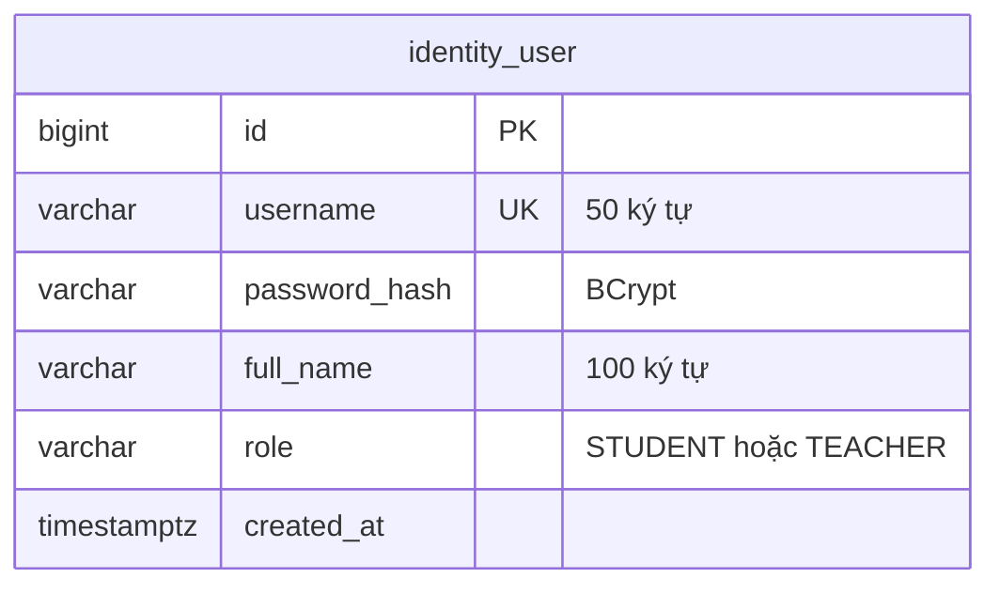
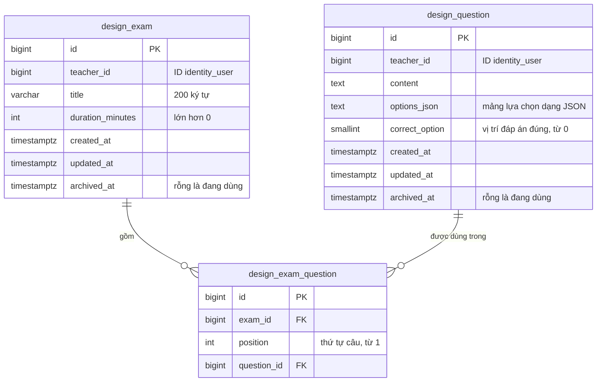
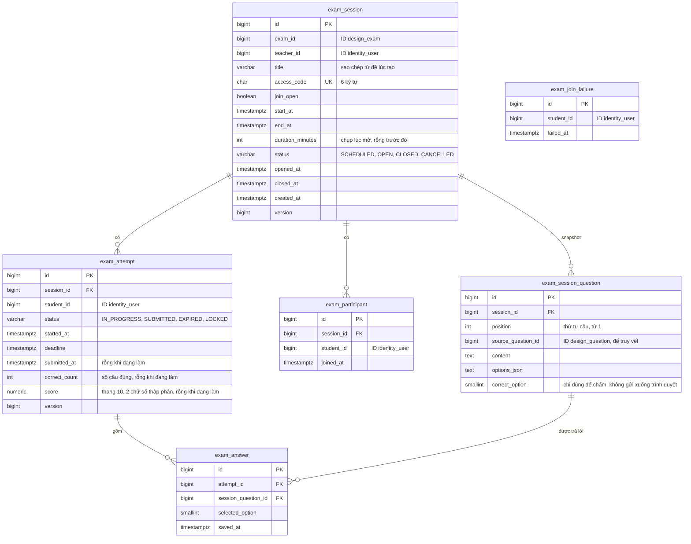
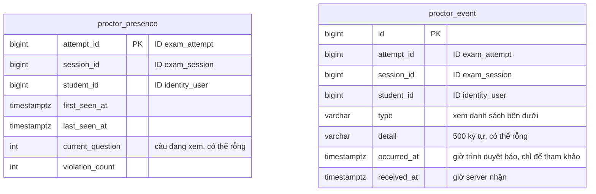

# Thiết kế cơ sở dữ liệu

Thiết kế bảng của bản MVP, theo từng module. Migration Flyway được viết theo thiết kế này khi cài đặt từng module ([ADR-0006](adr/0006-flyway-va-du-lieu-theo-module.md)). Trạng thái và luật chuyển trạng thái: [state-machines.md](state-machines.md).

## 1. Quy ước

| Hạng mục | Quy ước |
|---|---|
| Tên bảng | Tiền tố theo module: `identity_`, `design_`, `exam_`, `proctor_` |
| Khóa chính | `id BIGINT GENERATED BY DEFAULT AS IDENTITY`, trừ khi ghi chú khác |
| Thời gian | `TIMESTAMP WITH TIME ZONE`, lưu theo UTC |
| Enum | `VARCHAR` kèm ràng buộc `CHECK`, lưu tên hằng (`IN_PROGRESS`), không lưu số thứ tự |
| Liên kết **trong** một module | Cột ID có foreign key |
| Liên kết **giữa** các module | Chỉ cột ID, **không foreign key** ([ADR-0007](adr/0007-flat-id-linking.md)) |
| Xóa | Câu hỏi và đề xóa mềm bằng `archived_at`; các bảng khác không xóa trong MVP |
| Ghi đồng thời | Bảng có nhiều bên cùng ghi có cột `version` cho optimistic locking |

Database duy nhất là PostgreSQL ([ADR-0014](adr/0014-chi-dung-postgresql-test-bang-testcontainers.md)).

## 2. Tổng quan

| Module | Bảng |
|---|---|
| `identity` | `identity_user` |
| `examdesign` | `design_question`, `design_exam`, `design_exam_question` |
| `examination` | `exam_session`, `exam_session_question`, `exam_participant`, `exam_attempt`, `exam_answer`, `exam_join_failure` |
| `proctoring` | `proctor_presence`, `proctor_event` |

## 3. `identity`

- `username` lưu dạng đã chuẩn hóa (bỏ khoảng trắng hai đầu, chữ thường), nên `UNIQUE` thường đã chặn được trùng không phân biệt hoa thường, và đăng nhập cũng không phân biệt hoa thường.
- `password_hash` là `VARCHAR(100)`: BCrypt dài 60 ký tự, phần dư để dành nếu sau này đổi thuật toán băm.

## 4. `examdesign`

- `design_exam_question` là danh sách con của `Exam` (`@OneToMany`, đủ bốn điều kiện ở README mục 6.8), tối đa 100 câu một đề:
  - `UNIQUE (exam_id, position)` và `UNIQUE (exam_id, question_id)` (một câu không xuất hiện hai lần trong một đề).
  - Hai ràng buộc này là `DEFERRABLE INITIALLY DEFERRED`, kiểm tra lúc commit: khi thay danh sách câu, Hibernate thêm dòng mới trước rồi mới xóa dòng cũ, nên giữa chừng có lúc trùng.
  - Khóa chính là `id` riêng thay vì `(exam_id, position)`: cột `exam_id` do `@JoinColumn` phía `Exam` quản lý, thực thể con không có field trỏ về đề.
- **Lựa chọn của câu hỏi lưu dạng JSON** trong một cột `TEXT`, chuyển đổi bằng `AttributeConverter` viết tay. Lựa chọn luôn được đọc và ghi cùng câu hỏi, không bao giờ truy vấn bên trong nội dung JSON, nên `TEXT` là đủ. Nếu sau này cần truy vấn vào trong, có thể chuyển sang `JSONB`.

## 5. `examination`

- **`exam_session_question`** là bản sao đề chụp lúc mở kỳ thi ([ADR-0003](adr/0003-snapshot-de-khi-mo-ky-thi.md)). Sau khi mở, kỳ thi không cần `exam_id` nữa.
- **`access_code` duy nhất trên toàn bảng**, không chỉ trong các kỳ thi đang hoạt động: đơn giản hơn unique index có điều kiện, và 6 ký tự cho khoảng 2 tỷ tổ hợp nên không lo hết mã.
- **`exam_attempt`**: `UNIQUE (session_id, student_id)` đảm bảo mỗi học sinh một bài làm cho mỗi kỳ thi ngay ở tầng database. Khi cho làm nhiều lần sẽ đổi thành `UNIQUE (session_id, student_id, attempt_no)`.
- **`deadline` lưu sẵn** trong từng bài làm, tính một lần lúc bắt đầu; cộng giờ chỉ sửa bài của một học sinh ([ADR-0013](adr/0013-xu-ly-het-gio-lam-bai.md)).
- **`exam_answer`**: `UNIQUE (attempt_id, session_question_id)`, mỗi câu một đáp án; đổi đáp án là sửa dòng cũ, bỏ chọn là xóa dòng. Là danh sách con của `Attempt`, không có repository riêng.
- **`exam_attempt.score`** là `NUMERIC(4, 2)` (tối đa `10.00`). Ràng buộc `CHECK` bảo đảm bài `IN_PROGRESS` chưa có `submitted_at`, `correct_count`, `score`, còn bài đã kết thúc thì có đủ cả ba ([ADR-0016](adr/0016-moi-cau-mot-diem-quy-ve-thang-10.md)).
- **`exam_join_failure`** ghi các lần nhập sai mã để giới hạn 5 lần trong 15 phút ([ADR-0010](adr/0010-tham-gia-bang-ma-ky-thi.md)). Dòng cũ hơn 15 phút có thể xóa định kỳ.
- **`version`** có ở `exam_session` (giáo viên và job cùng mở hoặc đóng kỳ thi) và `exam_attempt` (học sinh, giáo viên và job cùng ghi).

## 6. `proctoring`

- **`proctor_presence`** chỉ chứa dữ liệu mà `proctoring` tự có; trạng thái bài làm luôn hỏi qua `ExaminationApi` ([ADR-0011](adr/0011-giam-sat-hoi-qua-examination-api.md)). Dòng được tạo ở heartbeat đầu tiên, sau khi đã xác nhận bài làm thuộc về học sinh đang gửi.
- **`proctor_event.type`**:
  - Từ trình duyệt: `TAB_HIDDEN`, `TAB_VISIBLE`, `FULLSCREEN_EXIT`.
  - Từ server: `DISCONNECTED`, `RECONNECTED`, ghi khi heartbeat đến sau một khoảng lặng quá 45 giây (`DISCONNECTED` lấy thời điểm `last_seen_at` cũ). Không cần job để phát hiện mất kết nối.
  - Thao tác của giáo viên: `TEACHER_EXTENDED_TIME`, `TEACHER_FORCED_SUBMIT`, `TEACHER_LOCKED`, ghi sau khi lời gọi `ExaminationApi` thành công, để có nhật ký kiểm tra.
- **`violation_count`** tăng khi nhận `TAB_HIDDEN` hoặc `FULLSCREEN_EXIT`, để màn hình giám sát không phải đếm lại nhật ký mỗi lần polling.
- `occurred_at` do trình duyệt gửi nên chỉ để tham khảo; mọi so sánh thời gian dùng `received_at`.

## 7. Tham chiếu giữa các module

Các cột dưới đây chỉ lưu ID, không có foreign key. Module sở hữu cột tự kiểm tra qua Api khi cần.

| Cột | Trỏ tới | Kiểm tra lúc nào |
|---|---|---|
| `design_question.teacher_id`, `design_exam.teacher_id`, `exam_session.teacher_id` | `identity_user.id` | Lấy từ người đang đăng nhập |
| `exam_participant.student_id`, `exam_attempt.student_id`, `exam_join_failure.student_id` | `identity_user.id` | Lấy từ người đang đăng nhập |
| `exam_session.exam_id` | `design_exam.id` | Khi tạo và khi mở kỳ thi, qua `ExamDesignApi` |
| `exam_session_question.source_question_id` | `design_question.id` | Không kiểm tra; chỉ để truy vết |
| `proctor_presence.*`, `proctor_event.*` (`attempt_id`, `session_id`, `student_id`) | `exam_attempt`, `exam_session`, `identity_user` | Heartbeat đầu tiên, qua `ExaminationApi` |

## 8. Index

| Bảng | Index | Phục vụ |
|---|---|---|
| `identity_user` | `UNIQUE (username)` | Đăng nhập |
| `design_question` | `(teacher_id, created_at)` | Danh sách câu hỏi của giáo viên, phân trang |
| `design_exam` | `(teacher_id, created_at)` | Danh sách đề của giáo viên |
| `design_exam_question` | `PK (exam_id, position)`, `UNIQUE (exam_id, question_id)`, `(question_id)` | Câu hỏi của đề; kiểm tra câu hỏi có đang nằm trong đề nào không |
| `exam_session` | `UNIQUE (access_code)`, `(teacher_id, start_at)`, `(status, start_at)`, `(status, end_at)` | Nhập mã; danh sách kỳ thi; job mở và đóng kỳ thi |
| `exam_session_question` | `UNIQUE (session_id, position)` | Đề của kỳ thi |
| `exam_participant` | `UNIQUE (session_id, student_id)` | Tham gia một lần; danh sách thí sinh |
| `exam_attempt` | `UNIQUE (session_id, student_id)`, `(status, deadline)`, `(student_id)` | Một bài mỗi kỳ thi; job chốt bài hết giờ; lịch sử của học sinh |
| `exam_answer` | `UNIQUE (attempt_id, session_question_id)` | Mỗi câu một đáp án |
| `exam_join_failure` | `(student_id, failed_at)` | Đếm số lần nhập sai gần đây |
| `proctor_presence` | `PK (attempt_id)`, `(session_id)` | Heartbeat; màn hình giám sát |
| `proctor_event` | `(session_id, received_at)`, `(attempt_id, received_at)` | Polling sự kiện mới (`?since=`); nhật ký của một học sinh |
