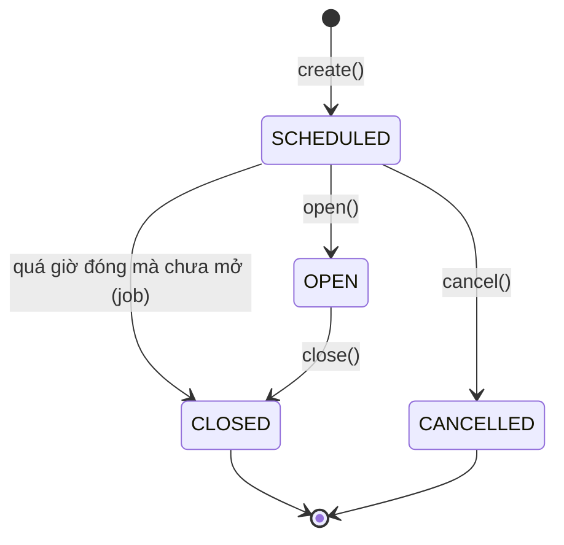
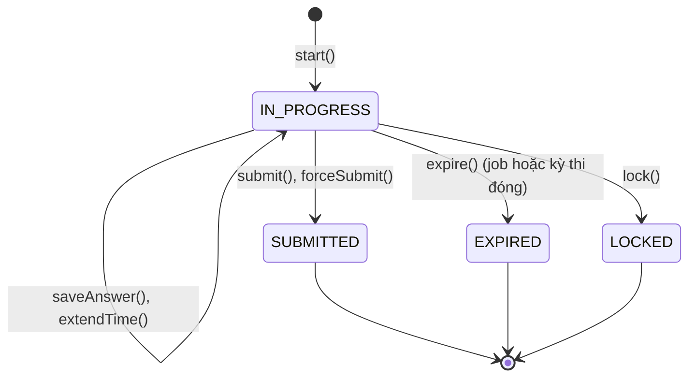
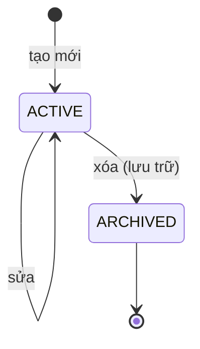

# State machine

Các thực thể có vòng đời trong hệ thống, trạng thái của chúng, và thao tác nào được phép ở trạng thái nào. Luật chuyển trạng thái nằm trong chính entity ([ADR-0008](adr/0008-khong-lombok-mapstruct.md)): mỗi thao tác là một hàm hành vi, kiểm tra điều kiện trước khi đổi trạng thái.

Thiết kế cơ sở dữ liệu tương ứng: [database.md](database.md).

## 1. Kỳ thi (`ExamSession`, module `examination`)

| Thao tác | Chuyển | Ai, khi nào | Điều kiện | Tác động |
|---|---|---|---|---|
| `create` | → `SCHEDULED` | Giáo viên | Đề tồn tại, chưa lưu trữ, có ít nhất 1 câu (hỏi `ExamDesignApi`); `start_at < end_at`; `end_at` ở tương lai | Lưu `exam_id`, sao chép tên đề; sinh `access_code`; `join_open = true` |
| `open` | `SCHEDULED` → `OPEN` | Giáo viên bấm "Bắt đầu", hoặc job khi tới `start_at` | `now < end_at`; lấy được snapshot đề | Chụp snapshot câu hỏi và thời lượng ([ADR-0003](adr/0003-snapshot-de-khi-mo-ky-thi.md)); ghi `opened_at` |
| `close` | `OPEN` → `CLOSED` | Job khi tới `end_at`, hoặc giáo viên kết thúc sớm | — | `join_open = false`; mọi bài `IN_PROGRESS` chuyển `EXPIRED` |
| `cancel` | `SCHEDULED` → `CANCELLED` | Giáo viên | — | Mã tham gia hết hiệu lực |
| (job) | `SCHEDULED` → `CLOSED` | Job khi quá `end_at` mà kỳ thi chưa được mở | — | Không có bài làm nào |
| `lockJoin` / `unlockJoin` | không đổi | Giáo viên | `SCHEDULED` hoặc `OPEN` | Đổi `join_open` |
| `regenerateCode` | không đổi | Giáo viên | `SCHEDULED` hoặc `OPEN` | Sinh mã mới, mã cũ hết hiệu lực |

Nếu job không mở được kỳ thi khi tới giờ (ví dụ đề đã bị xóa hết câu), kỳ thi giữ `SCHEDULED` và giáo viên thấy lỗi khi bấm mở thủ công.

**Thao tác được phép theo trạng thái:**

| | `SCHEDULED` | `OPEN` | `CLOSED` | `CANCELLED` |
|---|---|---|---|---|
| Học sinh nhập mã tham gia | ✓ nếu `join_open` | ✓ nếu `join_open` | ✗ | ✗ |
| Học sinh bắt đầu làm bài | ✗ | ✓ | ✗ | ✗ |
| Khóa/mở tham gia, đổi mã | ✓ | ✓ | ✗ | ✗ |
| Giám sát | — | ✓ | xem lại | — |
| Xem kết quả | — | bài đã kết thúc | ✓ | — |

Sai trạng thái trả `INVALID_SESSION_STATE`; nhập mã khi kỳ thi không nhận tham gia trả `INVALID_ACCESS_CODE`; đề không dùng được (không tồn tại, đã lưu trữ, không có câu nào) khi tạo hoặc mở kỳ thi trả `EXAM_NOT_AVAILABLE`.

## 2. Bài làm (`Attempt`, module `examination`)

| Thao tác | Chuyển | Ai | Điều kiện | Tác động |
|---|---|---|---|---|
| `start` | → `IN_PROGRESS` | Học sinh | Kỳ thi `OPEN`; đã tham gia; chưa có bài làm trong kỳ thi này | `deadline = min(now + thời lượng, end_at)` ([ADR-0013](adr/0013-xu-ly-het-gio-lam-bai.md)) |
| `saveAnswer` | giữ `IN_PROGRESS` | Học sinh | `now ≤ deadline + 5 giây` | Thêm hoặc sửa đáp án của một câu |
| `extendTime` | giữ `IN_PROGRESS` | Giáo viên | `now ≤ deadline`; số phút > 0 | `deadline` cộng thêm số phút |
| `submit` | → `SUBMITTED` | Học sinh | `now ≤ deadline + 5 giây` | Chấm điểm; `submitted_at = now` |
| `forceSubmit` | → `SUBMITTED` | Giáo viên | — | Chấm điểm; `submitted_at = now` |
| `expire` | → `EXPIRED` | Job, hoặc khi kỳ thi đóng | Quá hạn chót, hoặc kỳ thi đóng sớm | Chấm điểm; `submitted_at = deadline` (hoặc lúc đóng) |
| `lock` | → `LOCKED` | Giáo viên | — | Chấm điểm; `submitted_at = now`; bài được đánh dấu để giáo viên xem xét |

- Cả ba trạng thái kết thúc đều **có điểm**, tính từ các đáp án đã lưu. Trạng thái cho biết bài kết thúc bằng cách nào.
- Thao tác lên bài đã kết thúc trả lỗi theo trạng thái: `SUBMITTED` → `ATTEMPT_ALREADY_SUBMITTED`, `EXPIRED` hoặc quá hạn chót → `ATTEMPT_EXPIRED`, `LOCKED` → `ATTEMPT_LOCKED`.
- Bắt đầu làm bài khi chưa tham gia trả `NOT_A_PARTICIPANT`; bắt đầu lần thứ hai trả `ATTEMPT_ALREADY_STARTED`.
- Mọi thay đổi đều làm tăng `version` (kể cả lưu đáp án), để phát hiện thao tác đồng thời.
- Khi sau này có câu hỏi tự luận, sẽ cần thêm trạng thái chờ chấm giữa lúc kết thúc và lúc có điểm.

## 3. Câu hỏi và đề (`Question`, `Exam`, module `examdesign`)

Trạng thái được lưu bằng cột `archived_at` (rỗng là `ACTIVE`), không xóa hẳn dòng.

- Câu hỏi và đề đã lưu trữ không hiện trong danh sách và không thêm được vào đề mới hay kỳ thi mới.
- **Kỳ thi đã tạo từ một đề vẫn mở được** dù đề sau đó bị lưu trữ: `examdesign` không biết `examination` ([ADR-0004](adr/0004-public-api-va-chieu-phu-thuoc.md)), nên không thể kiểm tra "đề này có đang được kỳ thi nào dùng không" trước khi xóa. Xóa mềm tránh được vấn đề đó.
- Câu hỏi đang nằm trong một đề chưa lưu trữ thì không lưu trữ được, phải bỏ khỏi đề trước.

## 4. Những thứ không phải state machine

| Khái niệm | Vì sao không có trạng thái riêng |
|---|---|
| Tham gia kỳ thi (`SessionParticipant`) | Có dòng là đã tham gia; không có vòng đời nào khác |
| "Chưa vào thi" trên màn hình giám sát | Tính lúc đọc: đã tham gia nhưng chưa có bài làm |
| Online / mất kết nối | Tính lúc đọc: `now − last_seen_at` so với 45 giây ([ADR-0011](adr/0011-giam-sat-hoi-qua-examination-api.md)) |
| Số vi phạm | Bộ đếm, không phải trạng thái; giáo viên tự quyết định ([ADR-0012](adr/0012-mat-ket-noi-khong-tu-dong-xu-ly.md)) |
